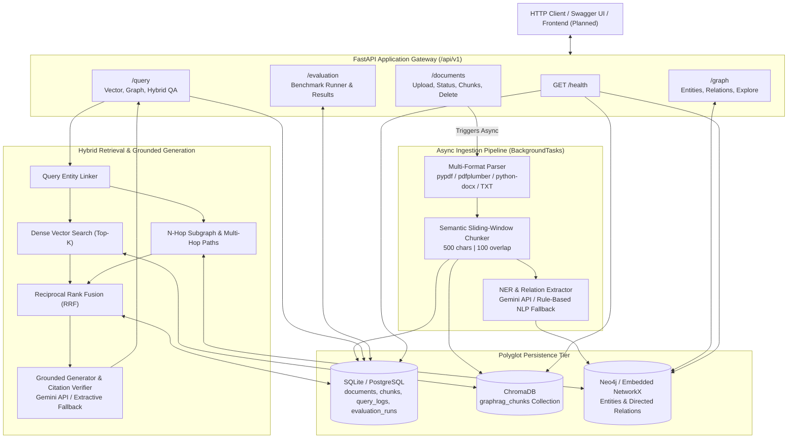
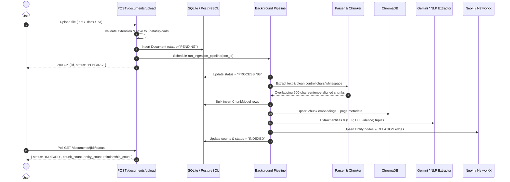
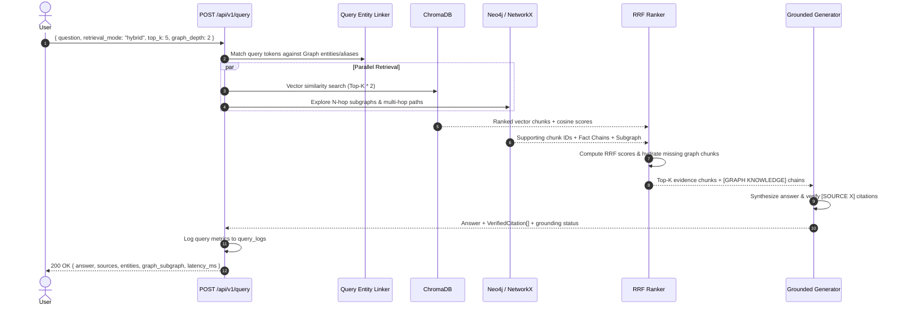
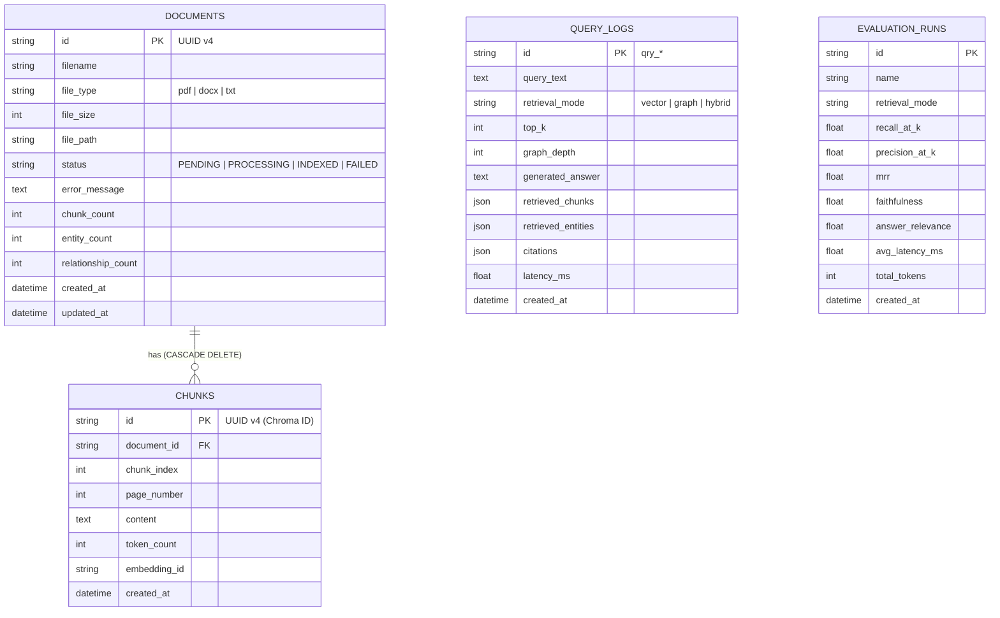

<div align="center">

# Synapse — GraphRAG Document Intelligence Platform

**Hybrid Knowledge Graph + Dense Vector Retrieval-Augmented Generation with Multi-Hop Reasoning & Verifiable Citations**

[](https://www.python.org/)
[](https://fastapi.tiangolo.com/)
[](https://www.trychroma.com/)
[](https://neo4j.com/)
[](https://www.docker.com/)
[](#testing--verification)

</div>

---

## Table of Contents

- [Overview](#overview)
- [Why GraphRAG?](#why-graphrag)
- [System Architecture](#system-architecture)
- [Core Workflows](#core-workflows)
  - [1. Asynchronous Ingestion & Knowledge Extraction](#1-asynchronous-ingestion--knowledge-extraction)
  - [2. Hybrid Retrieval & Grounded Generation](#2-hybrid-retrieval--grounded-generation)
- [Data Models & Polyglot Storage](#data-models--polyglot-storage)
- [Tech Stack](#tech-stack)
- [Project Structure](#project-structure)
- [Quick Start](#quick-start)
  - [Option A: Local Development (Zero External Dependencies)](#option-a-local-development-zero-external-dependencies)
  - [Option B: Docker Compose (Backend + Neo4j)](#option-b-docker-compose-backend--neo4j)
- [Configuration](#configuration)
- [REST API Reference](#rest-api-reference)
- [Testing & Verification](#testing--verification)
- [Implementation Roadmap](#implementation-roadmap)

---

## Overview

**Synapse** is an enterprise-ready **GraphRAG** (Knowledge Graph-Enhanced Retrieval-Augmented Generation) platform that bridges unstructured semantic vector search with structured knowledge graph traversal.

When documents (`.pdf`, `.docx`, `.txt`) are uploaded, Synapse asynchronously parses them, splits text along natural sentence boundaries, indexes dense embeddings in **ChromaDB**, extracts typed entities and directed semantic relationships into **Neo4j** (or an embedded **NetworkX** graph), and fuses vector and graph evidence using **Reciprocal Rank Fusion (RRF)** to synthesize answers backed by verified `[SOURCE X]` citations.

---

## Why GraphRAG?

Traditional vector-only RAG pipelines struggle on queries requiring:

1. **Multi-hop reasoning** across separate chunks or documents (e.g., $A \xrightarrow{\text{USES}} B \xrightarrow{\text{DEPENDS\_ON}} C$).
2. **Indirect entity relationship discovery** where keywords alone do not connect two concepts.
3. **Traceable provenance** linking every generated claim back to exact document pages, chunks, and supporting evidence excerpts.

| Capability | Standard Vector RAG | Synapse GraphRAG |
|---|---|---|
| Semantic chunk similarity | Yes | Yes (ChromaDB cosine search) |
| Multi-hop entity path discovery | No | Yes ($N$-hop BFS & path traversal) |
| Rank fusion across modalities | No | Yes (Reciprocal Rank Fusion, $k_0 = 60$) |
| Offline / zero-API-key fallback | Rarely | Yes (Embedded NetworkX + NLP rules + deterministic embeddings) |
| Strict citation verification | Limited | Yes (`[SOURCE X]` verified against retrieved chunks) |

---

## System Architecture

Synapse follows a layered, polyglot persistence architecture designed for graceful degradation—running out-of-the-box locally with zero external services, and scaling up to PostgreSQL, Neo4j, and Gemini API via environment variables.



---

## Core Workflows

### 1. Asynchronous Ingestion & Knowledge Extraction

Document uploads return immediately (`status: "PENDING"`) while heavy parsing, chunking, embedding, and graph extraction execute asynchronously via FastAPI `BackgroundTasks`.



### 2. Hybrid Retrieval & Grounded Generation

Queries in `hybrid` mode combine semantic similarity from ChromaDB with multi-hop relational paths from the Knowledge Graph using **Reciprocal Rank Fusion (RRF)**:

$$\text{RRF\_Score}(d) = \sum_{m \in \{\text{vector}, \text{graph}\}} \frac{w_m}{k_0 + r_m(d)}$$

where $k_0 = 60$, default weights $w_{\text{vector}} = 0.5$ and $w_{\text{graph}} = 0.5$ (or `1.0 / 0.0` in `vector`-only mode, `0.0 / 1.0` in `graph`-only mode), and $r_m(d)$ is the 1-based rank of chunk $d$.



---

## Data Models & Polyglot Storage

### Relational Schema (`SQLAlchemy` — SQLite / PostgreSQL)



### Property Graph Schema (`Neo4j` / Embedded `NetworkX`)

- **`Entity` Nodes**: Canonical normalized `id` (e.g., `TRANSFORMER`), display `name`, `type` (`PERSON`, `ORGANIZATION`, `LOCATION`, `TECHNOLOGY`, `CONCEPT`, `EVENT`), `description`, `aliases[]`, and `document_ids[]`.
- **`RELATION` Edges**: `id`, `source`, `target`, canonical uppercase `type` (`USES`, `DEVELOPED_BY`, `BASED_ON`, `DEPENDS_ON`, `PART_OF`, `TYPE_OF`, `INTRODUCED`, `RELATED_TO`), verbatim `evidence`, `confidence` (`0.0`–`1.0`), `document_id`, and `chunk_id`.

### Vector Store (`ChromaDB`)

- Collection `graphrag_chunks` configured with cosine distance (`hnsw:space: cosine`).
- Uses a built-in zero-dependency 384-dimensional L2-normalized embedding function (`FastDeterministicEmbeddingFunction`) for instant offline execution, storing `chunk_id`, `document_id`, `filename`, `page_number`, `chunk_index`, and `token_count` metadata.

---

## Tech Stack

| Layer | Technology |
|---|---|
| **API Framework** | FastAPI, Uvicorn, Pydantic v2, `pydantic-settings` |
| **Relational ORM** | SQLAlchemy 2.0 (SQLite default, PostgreSQL-ready) |
| **Vector Database** | ChromaDB (persistent local store) |
| **Knowledge Graph** | Neo4j (`neo4j` Bolt driver) with Embedded NetworkX + JSON fallback |
| **Document Parsing** | `pypdf`, `pdfplumber` (table-aware fallback), `python-docx` |
| **LLM & Extraction** | Google Gemini (`google-genai`) with Rule-Based NLP & Extractive Synthesis fallbacks |
| **Testing** | Pytest, FastAPI `TestClient` (`httpx`) |
| **Containerization** | Docker, Docker Compose (Neo4j 5.18 APOC + FastAPI) |

---

## Project Structure

```text
Synapse/
├── implementation.md               # Master technical specification & roadmap
├── README.md                       # Project documentation
├── docker-compose.yml              # Neo4j + FastAPI multi-container stack
├── .env.example                    # Environment configuration template
├── .gitignore                      # Ignores venv/, data/, *.db, caches
└── backend/
    ├── Dockerfile                  # Backend container image definition
    ├── pyproject.toml              # Build & pytest configuration
    ├── requirements.txt            # Python dependencies
    ├── config.py                   # Centralized Pydantic settings
    ├── database.py                 # SQLAlchemy models & session management
    ├── main.py                     # FastAPI entrypoint, lifespan, /health
    ├── api/
    │   ├── documents.py            # /api/v1/documents endpoints
    │   ├── graph.py                # /api/v1/graph exploration endpoints
    │   ├── query.py                # /api/v1/query hybrid QA endpoint
    │   └── evaluation.py           # /api/v1/evaluation endpoints
    ├── services/
    │   ├── parser.py               # PDF, DOCX, TXT multi-format parser & cleaner
    │   ├── chunker.py              # Semantic sliding-window chunker
    │   ├── extractor.py            # Gemini + Rule-based NER & relation extractor
    │   ├── pipeline.py             # Async ingestion orchestrator
    │   ├── vector_store.py         # ChromaDB client & embedding wrapper
    │   ├── graph_store.py          # Neo4j + Embedded NetworkX dual backend
    │   ├── retriever.py            # Entity linker, graph traversal & RRF fusion
    │   └── generator.py            # Grounded synthesis & [SOURCE X] verifier
    └── tests/
        ├── test_milestone1.py      # Storage, DB cascades & API tests (8 tests)
        ├── test_milestone2.py      # Parsing, chunking, extraction & pipeline tests (29 tests)
        └── test_milestone3.py      # RRF, multi-hop, citations & query API tests (9 tests)
```

---

## Quick Start

### Option A: Local Development (Zero External Dependencies)

Works out-of-the-box with SQLite, local ChromaDB, embedded NetworkX graph, and offline fallbacks (no API key or external DB required).

#### 1. Create a virtual environment and install dependencies

**Windows (PowerShell):**
```powershell
python -m venv venv
.\venv\Scripts\pip install -r backend\requirements.txt
```

**macOS / Linux:**
```bash
python3 -m venv venv
source venv/bin/activate
pip install -r backend/requirements.txt
```

#### 2. (Optional) Configure environment variables

Copy `.env.example` to `.env` if you want to enable Gemini LLM extraction/synthesis, PostgreSQL, or Neo4j:
```bash
cp .env.example .env
```

#### 3. Start the FastAPI server

**Windows (PowerShell):**
```powershell
$env:PYTHONPATH="."
.\venv\Scripts\uvicorn backend.main:app --host 0.0.0.0 --port 8000 --reload
```

**macOS / Linux:**
```bash
PYTHONPATH=. uvicorn backend.main:app --host 0.0.0.0 --port 8000 --reload
```

#### 4. Open interactive API docs

- **Swagger UI:** http://localhost:8000/docs
- **ReDoc:** http://localhost:8000/redoc
- **Health Check:** http://localhost:8000/health

---

### Option B: Docker Compose (Backend + Neo4j)

Launches Neo4j 5.18 (with APOC plugin) and the FastAPI backend together:

```bash
docker compose up --build
```

- **FastAPI Backend:** http://localhost:8000
- **Neo4j Browser UI:** http://localhost:7474 (default credentials: `neo4j` / `password`)

---

## Configuration

All settings are managed via [`backend/config.py`](backend/config.py) and loaded from `.env`:

| Variable | Default | Description |
|---|---|---|
| `ENVIRONMENT` | `development` | Runtime environment (`development` / `production`) |
| `HOST` / `PORT` | `0.0.0.0` / `8000` | Uvicorn server bind host and port |
| `DATABASE_URL` | `sqlite:///./data/graphrag.db` | SQLAlchemy URI (supports PostgreSQL URLs) |
| `CHROMA_PERSIST_DIR` | `./data/chroma` | Local persistence path for ChromaDB |
| `CHROMA_COLLECTION_NAME` | `graphrag_chunks` | ChromaDB collection name |
| `GRAPH_PERSIST_FILE` | `./data/embedded_graph.json` | JSON persistence path for NetworkX fallback |
| `NEO4J_ENABLED` | `false` | Set `true` to connect to Neo4j (falls back if unreachable) |
| `NEO4J_URI` | `bolt://localhost:7687` | Neo4j Bolt URI |
| `NEO4J_USER` / `NEO4J_PASSWORD` | `neo4j` / `password` | Neo4j authentication credentials |
| `GEMINI_API_KEY` | `None` | Google Gemini API key (optional; uses offline fallbacks if unset) |
| `LLM_MODEL` | `gemini-1.5-flash` | Gemini model ID for extraction and grounded QA |
| `CHUNK_SIZE` / `CHUNK_OVERLAP` | `500` / `100` | Sliding-window chunk target and overlap in characters |
| `UPLOAD_DIR` | `./data/uploads` | Local directory for uploaded source files |

---

## REST API Reference

All feature endpoints are mounted under `/api/v1`.

### System Health
- `GET /health` or `GET /api/v1/health` — Checks database, ChromaDB, and active graph store status.

### Document Management (`/api/v1/documents`)
- `POST /api/v1/documents/upload` — Upload `.pdf`, `.docx`, or `.txt` file (`multipart/form-data`) and trigger background ingestion.
- `GET /api/v1/documents` — List uploaded documents and processing status.
- `GET /api/v1/documents/{document_id}/status` — Poll status (`PENDING`, `PROCESSING`, `INDEXED`, `FAILED`) and chunk/entity/edge counts.
- `GET /api/v1/documents/{document_id}/chunks` — Inspect extracted text chunks and page numbers.
- `DELETE /api/v1/documents/{document_id}` — Cascading delete across SQLite/PostgreSQL, ChromaDB vectors, Knowledge Graph edges/orphan nodes, and disk storage.

### Knowledge Graph (`/api/v1/graph`)
- `GET /api/v1/graph/entities?entity_type=TECHNOLOGY&search=transformer&limit=50` — List/filter entities sorted by degree.
- `GET /api/v1/graph/relationships?source_entity=TRANSFORMER&limit=100` — List directed edges with supporting evidence.
- `POST /api/v1/graph/explore` — Explore the $N$-hop neighborhood subgraph around a focal entity.
- `GET /api/v1/graph/stats` — Active graph backend metrics.

### Hybrid Query & Reasoning (`/api/v1/query`)

**Request:**
```bash
curl -X POST http://localhost:8000/api/v1/query \
  -H "Content-Type: application/json" \
  -d '{
    "question": "How does self-attention work in the Transformer architecture?",
    "retrieval_mode": "hybrid",
    "top_k": 5,
    "graph_depth": 2,
    "include_citations": true
  }'
```

**Response:**
```json
{
  "query_id": "qry_a1b2c3d4",
  "question": "How does self-attention work in the Transformer architecture?",
  "answer": "The Transformer relies entirely on self-attention mechanisms... [SOURCE 1]",
  "retrieval_mode": "hybrid",
  "sources": [
    {
      "citation_id": 1,
      "document_id": "f5a7a942-...",
      "filename": "attention.pdf",
      "page": 1,
      "chunk_id": "chk_001",
      "excerpt": "The Transformer architecture relies entirely on an attention mechanism..."
    }
  ],
  "entities": ["Transformer", "Self-Attention"],
  "graph_subgraph": {
    "nodes": [
      {"id": "TRANSFORMER", "label": "Transformer", "type": "TECHNOLOGY", "degree": 2}
    ],
    "edges": [
      {"id": "rel_123", "source": "TRANSFORMER", "target": "SELF_ATTENTION", "type": "USES"}
    ]
  },
  "latency_ms": 42.8,
  "model_used": "extractive_synthesizer",
  "is_fully_grounded": true
}
```

### Evaluation (`/api/v1/evaluation`)
- `POST /api/v1/evaluation/run` — Trigger retrieval mode comparison runs (`vector`, `graph`, `hybrid`).
- `GET /api/v1/evaluation/results` — Retrieve historical evaluation run records.

---

## Testing & Verification

Run the full automated test suite (46 tests covering storage engines, ingestion pipeline, RRF retrieval, citation verification, and FastAPI endpoints):

**Windows (PowerShell):**
```powershell
$env:PYTHONPATH="."
.\venv\Scripts\pytest -v backend\tests\
```

**macOS / Linux:**
```bash
PYTHONPATH=. pytest -v backend/tests/
```

---


