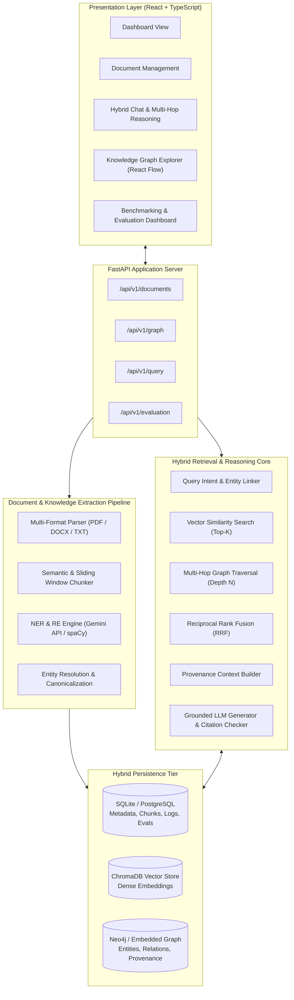
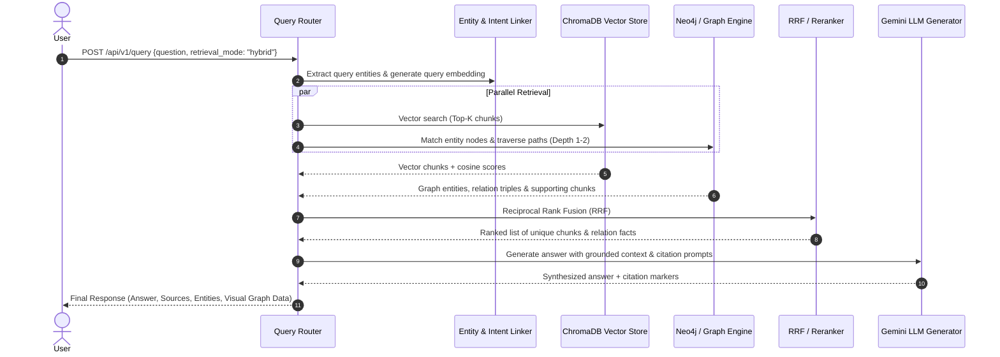

# GraphRAG System Implementation Plan & Technical Specification

**Document Version:** 1.0.0  
**Project:** GraphRAG (Knowledge Graph-Enhanced Retrieval-Augmented Generation)  
**Status:** Approved for Implementation  
**Target Environment:** Python 3.12+ (FastAPI), React 19 (TypeScript + Vite + Tailwind CSS), Neo4j, ChromaDB, SQLite/PostgreSQL  

---

## 1. Executive Summary & Objective

This document defines the comprehensive technical implementation plan for **GraphRAG**, an enterprise-grade document intelligence platform that bridges unstructured semantic vector retrieval with structured knowledge graph traversal. 

Standard RAG architectures frequently fail when queries require:
1. **Multi-hop reasoning** across multiple distinct documents or sections.
2. **Entity relationship discovery** where connections are indirect (e.g., $A \rightarrow B \rightarrow C$).
3. **Global context awareness** and verifiable citation traceability.

GraphRAG solves these bottlenecks by extracting named entities and directed semantic relationships, indexing chunks in ChromaDB and property graphs in Neo4j (with embedded Graph engine fallback), and executing hybrid rank-fused retrieval for grounded LLM answer generation with strict citation verification.

---

## 2. System Architecture & Data Flow



---

## 3. Data Models & Database Schemas

### 3.1 Relational Schema (SQLAlchemy / SQLite & PostgreSQL)

#### `documents` Table
| Column | Type | Constraints | Description |
|---|---|---|---|
| `id` | `VARCHAR(36)` | PRIMARY KEY | UUID v4 |
| `filename` | `VARCHAR(255)` | NOT NULL | Original uploaded filename |
| `file_type` | `VARCHAR(10)` | NOT NULL | `pdf`, `docx`, `txt` |
| `file_size` | `INTEGER` | NOT NULL | File size in bytes |
| `file_path` | `VARCHAR(512)` | NOT NULL | Local storage path |
| `status` | `VARCHAR(30)` | NOT NULL | `PENDING`, `PROCESSING`, `INDEXED`, `FAILED` |
| `error_message` | `TEXT` | NULLABLE | Failure reason if failed |
| `chunk_count` | `INTEGER` | DEFAULT 0 | Total number of chunks generated |
| `entity_count` | `INTEGER` | DEFAULT 0 | Total number of entities extracted |
| `relationship_count` | `INTEGER` | DEFAULT 0 | Total relationships extracted |
| `created_at` | `DATETIME` | DEFAULT UTC NOW | Ingestion timestamp |
| `updated_at` | `DATETIME` | DEFAULT UTC NOW | Last update timestamp |

#### `chunks` Table
| Column | Type | Constraints | Description |
|---|---|---|---|
| `id` | `VARCHAR(36)` | PRIMARY KEY | UUID v4 (references Vector ID) |
| `document_id` | `VARCHAR(36)` | FOREIGN KEY -> `documents.id` (CASCADE) | Source document |
| `chunk_index` | `INTEGER` | NOT NULL | Positional index within document |
| `page_number` | `INTEGER` | NULLABLE | Page number for PDFs / docs |
| `content` | `TEXT` | NOT NULL | Raw text content of the chunk |
| `token_count` | `INTEGER` | NOT NULL | Estimated token length |
| `embedding_id` | `VARCHAR(64)` | NULLABLE | ChromaDB record ID |
| `created_at` | `DATETIME` | DEFAULT UTC NOW | Creation timestamp |

#### `query_logs` Table
| Column | Type | Constraints | Description |
|---|---|---|---|
| `id` | `VARCHAR(36)` | PRIMARY KEY | Query execution UUID |
| `query_text` | `TEXT` | NOT NULL | User natural-language question |
| `retrieval_mode` | `VARCHAR(20)` | NOT NULL | `vector`, `graph`, `hybrid` |
| `top_k` | `INTEGER` | NOT NULL | Retrieval K parameter |
| `graph_depth` | `INTEGER` | NOT NULL | Traversal depth (e.g. 1, 2, 3) |
| `generated_answer` | `TEXT` | NOT NULL | LLM generated answer |
| `retrieved_chunks` | `JSON` | NOT NULL | Array of retrieved chunk IDs & scores |
| `retrieved_entities`| `JSON` | NOT NULL | Array of connected entities traversed |
| `citations` | `JSON` | NOT NULL | Array of verified citation objects |
| `latency_ms` | `FLOAT` | NOT NULL | Total end-to-end latency |
| `created_at` | `DATETIME` | DEFAULT UTC NOW | Query timestamp |

#### `evaluation_runs` Table
| Column | Type | Constraints | Description |
|---|---|---|---|
| `id` | `VARCHAR(36)` | PRIMARY KEY | Evaluation run UUID |
| `name` | `VARCHAR(100)` | NOT NULL | Experiment/Dataset name |
| `retrieval_mode` | `VARCHAR(20)` | NOT NULL | `vector` vs `graph` vs `hybrid` |
| `recall_at_k` | `FLOAT` | NOT NULL | Evidence recall metric |
| `precision_at_k` | `FLOAT` | NOT NULL | Evidence precision metric |
| `mrr` | `FLOAT` | NOT NULL | Mean Reciprocal Rank |
| `faithfulness` | `FLOAT` | NOT NULL | LLM context faithfulness score (0.0 - 1.0) |
| `answer_relevance`| `FLOAT` | NOT NULL | Query answer relevance score (0.0 - 1.0) |
| `avg_latency_ms` | `FLOAT` | NOT NULL | Average latency in milliseconds |
| `total_tokens` | `INTEGER` | NOT NULL | Total token consumption |
| `created_at` | `DATETIME` | DEFAULT UTC NOW | Run timestamp |

---

### 3.2 Property Graph Schema (Neo4j / Embedded Graph Store)

#### Graph Nodes
* **`Entity`**:
  * `id`: `string` (unique canonical normalized name, e.g., `"TRANSFORMER"`)
  * `name`: `string` (display name, e.g., `"Transformer"`)
  * `type`: `string` (`PERSON`, `ORGANIZATION`, `LOCATION`, `TECHNOLOGY`, `CONCEPT`, `EVENT`)
  * `description`: `string` (brief summarized description)
  * `aliases`: `list[string]` (known synonyms/aliases)
  * `document_ids`: `list[string]` (documents mentioning this entity)

#### Graph Relationships (Edges)
* **`RELATION`**:
  * `id`: `string` (unique relationship ID)
  * `source`: `string` (source entity ID)
  * `target`: `string` (target entity ID)
  * `type`: `string` (canonical uppercase predicate, e.g., `USES`, `DEVELOPED_BY`, `PART_OF`, `INFLUENCED`)
  * `evidence`: `string` (supporting text excerpt from document)
  * `confidence`: `float` (confidence score 0.0 to 1.0)
  * `document_id`: `string` (originating document)
  * `chunk_id`: `string` (originating chunk UUID)

---

### 3.3 Vector Store Schema (ChromaDB)

* **Collection Name**: `graphrag_chunks`
* **Embedding Model**: `sentence-transformers/all-MiniLM-L6-v2` (384 dimensions) or Google Gemini Embeddings (`text-embedding-004`, 768 dimensions)
* **Document**: Raw text content of the chunk
* **Metadata Schema**:
  ```json
  {
    "chunk_id": "3f2e1a4b-...",
    "document_id": "7b8c9d0e-...",
    "filename": "attention_is_all_you_need.pdf",
    "page_number": 3,
    "chunk_index": 12,
    "token_count": 240
  }
  ```

---

## 4. Ingestion & Processing Pipeline Specifications

### 4.1 Document Parsing (FR-01, FR-02)
1. **File Type Detection**: Validate MIME types and extensions (`.pdf`, `.docx`, `.txt`).
2. **Text Extraction**:
   - `PDF`: Page-by-page extraction via `pypdf` / `pdfplumber` maintaining continuous page index.
   - `DOCX`: Paragraph and table parsing via `python-docx`.
   - `TXT`: UTF-8 decoding with fallback encoding normalization.
3. **Text Cleaning**: Strip non-printable control characters, normalize redundant whitespace, and preserve paragraph boundaries.

### 4.2 Semantic Chunking Engine (FR-02)
- **Target Size**: 500 characters / ~120-150 tokens.
- **Overlap**: 100 characters / ~25 tokens sliding window.
- **Boundary Preservation**: Split on natural sentence endings (`. `, `\n\n`) to prevent splitting mid-thought or mid-entity.
- **Metadata Tagging**: Every chunk retains `{document_id, chunk_id, page_number, chunk_index}`.

### 4.3 Entity & Relationship Extraction (FR-03, FR-04, FR-05)
1. **Extraction Strategy**:
   - Pass chunk text to Gemini structured prompt / spaCy NLP extractor.
   - Extract entities constrained to categories: `PERSON`, `ORGANIZATION`, `LOCATION`, `TECHNOLOGY`, `CONCEPT`, `EVENT`.
   - Extract triples: `(Subject: Entity, Predicate: Relation, Object: Entity, Evidence: text)`.
2. **Entity Resolution & Canonicalization**:
   - Strip leading/trailing punctuation, case normalization.
   - Alias mapping (e.g., `"Google Inc."` and `"Google"` mapped to canonical `"GOOGLE"`).
3. **Graph Persistence**:
   - Atomic upsert of nodes (`MERGE (e:Entity {id: $id}) ...`).
   - Creation of directed edges linking source and target with chunk provenance.
4. **Vector Indexing**:
   - Batch embed chunk text.
   - Insert embeddings into ChromaDB collection with full metadata.

---

## 5. Hybrid Retrieval & Multi-Hop Reasoning Engine

### 5.1 Query Flow & Processing (FR-07, FR-08, FR-09, FR-10)



### 5.2 Reciprocal Rank Fusion (RRF) Formula (FR-09)
For an item $d$ appearing in ranked retrieval lists $R_{\text{vector}}$ and $R_{\text{graph}}$:

$$\text{RRF\_Score}(d) = \sum_{m \in \{\text{vector}, \text{graph}\}} \frac{w_m}{k_0 + r_m(d)}$$

Where:
- $k_0 = 60$ (smoothing constant).
- $w_m$ is the configurable retrieval mode weight (default $0.5$ vector, $0.5$ graph).
- $r_m(d)$ is the 1-based rank of item $d$ in system $m$.

### 5.3 Multi-Hop Path Discovery (FR-10)
- Extract query entities $E_Q = \{e_1, e_2, \dots\}$.
- Traverse 2-hop neighborhoods in the knowledge graph:
  $$\text{Path: } e_1 \xrightarrow{r_1} e_{\text{intermediate}} \xrightarrow{r_2} e_2$$
- Retrieve all associated evidence text from the intermediate relationships.
- Inject the intermediate relational chain into the context:
  `[FACT CHAIN]: (Transformer) -> [USES] -> (Multi-Head Attention) -> [DEPENDS_ON] -> (Scaled Dot-Product)`

### 5.4 Grounded Generation & Citation Verification (FR-11, FR-12)
1. **Context Construction**: Formatted with clear block markers:
   ```text
   [SOURCE 1 | Document: Attention.pdf | Page: 3 | Chunk: chunk_012]
   "The Transformer uses multi-head self-attention..."

   [GRAPH KNOWLEDGE]:
   - (Transformer) -[USES]-> (Self-Attention) (Source: chunk_012)
   ```
2. **Citation Requirement**: The LLM prompt enforces referencing `[SOURCE X]` explicitly for every assertion.
3. **Verification**: The backend verifies that every cited `[SOURCE X]` corresponds to an actually retrieved chunk before returning the response.

---

## 6. REST API Endpoint Specifications

### 6.1 Document Management

#### `POST /api/v1/documents/upload`
- **Request**: `multipart/form-data` with `file: UploadFile`.
- **Response**:
  ```json
  {
    "document_id": "f5a7a942-e1a5-4221-a39c-5ebcbfd43701",
    "filename": "graph_rag_paper.pdf",
    "file_type": "pdf",
    "file_size": 204850,
    "status": "PROCESSING",
    "created_at": "2026-11-01T13:15:00Z"
  }
  ```

#### `GET /api/v1/documents`
- **Response**: Array of document metadata items.

#### `GET /api/v1/documents/{id}/status`
- **Response**:
  ```json
  {
    "document_id": "f5a7a942-e1a5-4221-a39c-5ebcbfd43701",
    "status": "INDEXED",
    "chunk_count": 24,
    "entity_count": 38,
    "relationship_count": 52,
    "error_message": null
  }
  ```

#### `DELETE /api/v1/documents/{id}`
- **Behavior**: Cascading deletion from SQLite/PostgreSQL, ChromaDB vectors, and Neo4j nodes/edges originating from this document.

---

### 6.2 Knowledge Graph Exploration

#### `GET /api/v1/graph/entities`
- **Query Params**: `entity_type` (optional), `limit` (default 50), `search` (optional).
- **Response**: List of entity nodes with names, types, and connection degrees.

#### `GET /api/v1/graph/relationships`
- **Query Params**: `source_entity` (optional), `limit` (default 100).
- **Response**: List of edges with source, target, predicate, and evidence chunk ID.

#### `POST /api/v1/graph/explore`
- **Request**:
  ```json
  {
    "entity_name": "Transformer",
    "depth": 2,
    "limit": 50
  }
  ```
- **Response**: Subgraph `{nodes: [...], edges: [...]}` optimized for visual node-link rendering.

---

### 6.3 Query & Multi-Hop Reasoning

#### `POST /api/v1/query`
- **Request**:
  ```json
  {
    "question": "How does self-attention enable multi-hop relations in transformers?",
    "retrieval_mode": "hybrid",
    "top_k": 5,
    "graph_depth": 2,
    "include_citations": true
  }
  ```
- **Response**:
  ```json
  {
    "query_id": "qry_883019",
    "question": "How does self-attention enable multi-hop relations in transformers?",
    "answer": "Self-attention computes dynamic weights between tokens [SOURCE 1]...",
    "retrieval_mode": "hybrid",
    "sources": [
      {
        "citation_id": 1,
        "document_id": "f5a7a942-...",
        "filename": "graph_rag_paper.pdf",
        "page": 4,
        "chunk_id": "chunk_014",
        "excerpt": "Self-attention layers correlate distant tokens directly..."
      }
    ],
    "entities": ["Transformer", "Self-Attention", "Token"],
    "graph_subgraph": {
      "nodes": [
        {"id": "TRANSFORMER", "label": "Transformer", "type": "TECHNOLOGY"},
        {"id": "SELF-ATTENTION", "label": "Self-Attention", "type": "CONCEPT"}
      ],
      "edges": [
        {"source": "TRANSFORMER", "target": "SELF-ATTENTION", "type": "USES"}
      ]
    },
    "latency_ms": 1150.4
  }
  ```

---

### 6.4 Evaluation & Benchmarking

#### `POST /api/v1/evaluation/run`
- **Request**:
  ```json
  {
    "benchmark_dataset": "standard_academic_qa",
    "modes": ["vector", "hybrid"],
    "sample_size": 10
  }
  ```
- **Response**: Benchmark run results comparing Vector RAG vs GraphRAG on Recall@K, MRR, Faithfulness, Answer Relevance, and Latency.

#### `GET /api/v1/evaluation/results`
- **Response**: Historical list of evaluation runs and comparative metrics.

---

## 7. Frontend User Interface Specifications

The frontend will be built with **React 19 + TypeScript + Vite + Tailwind CSS**, organized into five primary pages:

### 7.1 Dashboard (`/`)
- Key metric cards: Total Indexed Documents, Knowledge Graph Entities, Extracted Relationships, Total Queries Run.
- System Health Indicator: Backend API status, Vector DB status, Graph Store status.
- Recent Activity Feed: Latest uploaded documents and recent queries with latency badges.

### 7.2 Document Management (`/documents`)
- Drag-and-drop file uploader supporting `.pdf`, `.docx`, `.txt`.
- Data table listing all documents with real-time status badges (`PROCESSING`, `INDEXED`, `FAILED`).
- Chunk inspector drawer: Allows inspecting chunk text, page provenance, and extracted entities for any document.
- Single-click document deletion with automatic index cleanup.

### 7.3 Hybrid Chat & Reasoning (`/chat`)
- Conversational chat interface with retrieval mode switcher (`Hybrid (Vector + Graph)`, `Vector Only`, `Graph Only`).
- Real-time parameter drawer: Adjust `top_k` (1–20), `graph_depth` (1–3), and temperature.
- Interactive Answer Cards:
  - Formatted markdown response with clickable citation badges `[1]`, `[2]`.
  - Side-panel drawer showing exact source chunk, page number, and evidence text when citation is clicked.
  - Multi-hop reasoning chain visualizer highlighting intermediate entity hops.

### 7.4 Knowledge Graph Explorer (`/graph`)
- Interactive canvas powered by **React Flow / Force Graph**.
- Entity node color-coding by category (`PERSON`: purple, `ORGANIZATION`: blue, `TECHNOLOGY`: emerald, `CONCEPT`: amber, `LOCATION`: cyan, `EVENT`: rose).
- Search & Filter bar: Filter nodes by entity category or search entity by name.
- Node inspection panel: Clicking a node displays its connected neighbors, originating documents, and relationship attributes.
- Path highlighter: Trace connection paths between any selected pair of entities.

### 7.5 Evaluation & Benchmark Studio (`/evaluation`)
- Trigger comparative evaluation runs between Vector RAG and GraphRAG.
- Side-by-side comparison charts:
  - Retrieval Metrics: Recall@K, Precision@K, MRR.
  - Generation Metrics: Faithfulness (hallucination reduction), Answer Relevance.
  - Performance Metrics: Average Latency (ms), Token Usage.
- Downloadable evaluation report (JSON / CSV).

---

## 8. Directory Structure

```text
graphrag/
├── IMPLEMENTATION.md               # This specification document
├── README.md                       # Setup and running instructions
├── docker-compose.yml              # Unified orchestration (FastAPI, React, Neo4j)
├── .env.example                    # Template environment variables
├── backend/
│   ├── pyproject.toml              # Dependencies and build configuration
│   ├── requirements.txt            # Python requirements
│   ├── main.py                     # FastAPI server entrypoint
│   ├── config.py                   # Pydantic BaseSettings configuration
│   ├── database.py                 # SQLite/Postgres connection & SQLAlchemy models
│   ├── api/
│   │   ├── __init__.py
│   │   ├── documents.py            # Document upload & management endpoints
│   │   ├── graph.py                # Entity and relationship exploration endpoints
│   │   ├── query.py                # Retrieval and query answering endpoints
│   │   └── evaluation.py           # Evaluation runner and metrics endpoints
│   ├── services/
│   │   ├── __init__.py
│   │   ├── parser.py               # PDF, DOCX, TXT parser
│   │   ├── chunker.py              # Semantic sliding-window chunker
│   │   ├── extractor.py            # NER and Relationship extraction (Gemini / NLP)
│   │   ├── vector_store.py         # ChromaDB client & embedding management
│   │   ├── graph_store.py          # Neo4j client + Embedded NetworkX Graph fallback
│   │   ├── retriever.py            # Hybrid retrieval & RRF rank fusion
│   │   ├── generator.py            # Grounded generation & citation verification
│   │   └── evaluator.py            # Benchmark execution & scoring engine
│   └── tests/
│       ├── test_parser.py          # Document parsing unit tests
│       ├── test_extractor.py       # Entity & relation extraction tests
│       ├── test_retriever.py       # Hybrid retrieval and RRF tests
│       └── test_api.py             # FastAPI endpoint integration tests
└── frontend/
    ├── package.json
    ├── vite.config.ts
    ├── tsconfig.json
    ├── tailwind.config.js
    ├── index.html
    └── src/
        ├── main.tsx                # React root
        ├── App.tsx                 # Navigation & route definitions
        ├── api/
        │   └── client.ts           # Typed Axios/Fetch API client
        ├── types/
        │   └── index.ts            # TypeScript interfaces matching API schemas
        ├── components/
        │   ├── Navbar.tsx          # Top navigation bar
        │   ├── CitationCard.tsx    # Source citation preview component
        │   ├── StatusBadge.tsx     # Processing status indicators
        │   └── GraphCanvas.tsx     # React Flow interactive graph component
        └── pages/
            ├── Dashboard.tsx       # System summary dashboard
            ├── Documents.tsx       # Document upload and table management
            ├── Chat.tsx            # Query interface with hybrid reasoning
            ├── GraphExplorer.tsx   # Interactive full-screen graph explorer
            └── Evaluation.tsx      # RAG vs GraphRAG benchmark comparison
```

---

## 9. Implementation Milestones & Execution Order

| Milestone | Deliverables | Verification Criteria |
|---|---|---|
| **Milestone 1: Backend Foundation & Storage** | FastAPI app, database schemas, ChromaDB client, Graph Store (Neo4j + Embedded fallback) | DB migrations run, health check passes, Chroma & Graph store initialized |
| **Milestone 2: Ingestion & Knowledge Extraction** | Parsers (PDF/DOCX/TXT), chunker, LLM/NLP entity & relation extractor | Uploading sample document yields parsed chunks, entities, and stored edges |
| **Milestone 3: Hybrid Retrieval & Grounded Generation** | Query entity linker, vector search, graph multi-hop traversal, RRF fusion, grounded LLM generator | Multi-hop query returns evidence-backed answer with verifiable citations |
| **Milestone 4: Evaluation Engine & Benchmarking** | Synthetic/academic benchmark dataset, metric calculators (Recall, MRR, Faithfulness, Latency) | `/api/v1/evaluation/run` outputs comparative metrics between Vector RAG and GraphRAG |
| **Milestone 5: Modern React Frontend UI** | Vite + React + Tailwind frontend with all 5 screens, React Flow graph visualization | User can upload docs, view graph, chat with citations, and view evaluation results in browser |
| **Milestone 6: Verification, Dockerization & Documentation** | Automated test suite, `docker-compose.yml`, user guide and API documentation | Clean test run, single-command `docker compose up` launch, complete SRS compliance |

---

## 10. Summary

This implementation specification forms the definitive blueprint for constructing GraphRAG. Development can proceed immediately starting from **Milestone 1 (Backend Foundation & Storage Engines)**.